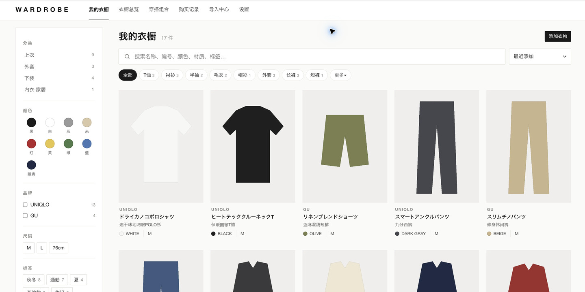

# Wardrobe

English · [简体中文](README.md) · [日本語](README.ja.md)

Manage clothing, products, outfits and purchases with photos, filters, tags, import previews, and a REST API. Local suggestions require review before application. GPT and Claude assisted with implementation and review of the Vue, TypeScript, FastAPI and SQLite app.

## Interface language

Use the selector at the right of the top navigation to choose Simplified Chinese, Japanese, or English. The interface defaults to Simplified Chinese and remembers the selection in the same browser. Saved item names, notes, and other record content retain their original text.

## Screenshots

The local demo library with fictional clothing records and sample images.



## Fictional-data demo

On macOS, install uv, Python 3.12 and Node.js 24+. Run from the repository root. Open http://127.0.0.1:18765. The demo uses a separate directory and port and seeds only an empty database.

```sh
cd wardrobe
export WARDROBE_DATA_DIR="$PWD/data/demo" WARDROBE_PORT=18765
./wardrobe start --no-open
./wardrobe seed-demo
```

Stop the demo from the wardrobe folder.

```sh
WARDROBE_DATA_DIR="$PWD/data/demo" WARDROBE_PORT=18765 ./wardrobe stop
```
