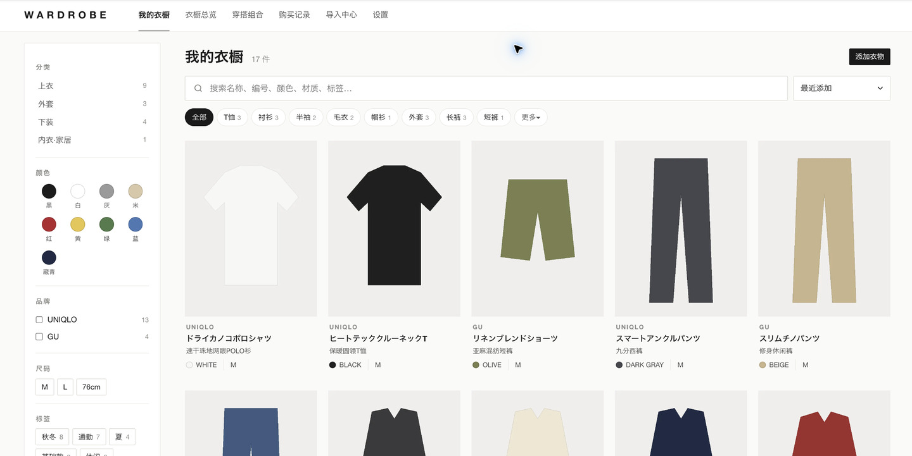

# Wardrobe · デジタルクローゼット

[English](README.en.md) · [简体中文](README.md) · 日本語

衣類、商品、コーディネート、購入記録を管理します。写真、絞り込み、タグ、インポートのプレビュー、REST APIに対応します。端末内で計算した候補は確認してから反映します。Vue、TypeScript、FastAPI、SQLiteを使用し、GPTとClaudeが実装とレビューを支援しました。

## 画面例

架空の衣類データとサンプル画像を使ったローカルデモです。



## 架空のデータで試す

macOSにuv、Python 3.12、Node.js 24以上を用意し、リポジトリのルートで実行します。http://127.0.0.1:18765 を開きます。デモ専用のディレクトリとポートを使い、空のデータベースにのみサンプルを追加します。

```sh
cd wardrobe
export WARDROBE_DATA_DIR="$PWD/data/demo" WARDROBE_PORT=18765
./wardrobe start --no-open
./wardrobe seed-demo
```

停止するには、wardrobeディレクトリで以下を実行します。

```sh
WARDROBE_DATA_DIR="$PWD/data/demo" WARDROBE_PORT=18765 ./wardrobe stop
```
